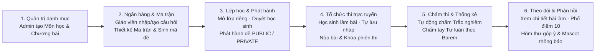

# Exam Matrix — Hệ thống Quản lý Ngân hàng Câu hỏi, Sinh Ma trận Đề & Tổ chức Thi Trực tuyến

**Exam Matrix** là nền tảng web hỗ trợ các cơ sở đào tạo và giảng viên chuẩn hóa ngân hàng câu hỏi, thiết kế ma trận đề thi khoa học, sinh mã đề tự động và tổ chức thi/chấm thi trực tuyến trên **thang điểm 10 thống nhất**.

---

## 1. Phân hệ Nghiệp vụ theo Vai trò

| Vai trò | Chức năng chính |
| :--- | :--- |
| **Quản trị viên (`ADMIN`)** | • Quản lý tài khoản người dùng, phân quyền (`ADMIN`, `TEACHER`, `STUDENT`) và trạng thái hoạt động.<br>• Quản lý danh mục **Môn học** và **Chương bài** dùng chung toàn hệ thống.<br>• Theo dõi kết quả thi toàn hệ thống, thống kê lượt truy cập theo tuần và bảng xếp hạng hoạt động.<br>• Tiếp nhận toàn bộ góp ý, đề xuất môn học/đề thi từ học sinh qua **Hòm thư góp ý**. |
| **Giáo viên (`TEACHER`)** | • Xây dựng **Ngân hàng câu hỏi** theo môn, chương, độ khó (`Dễ`, `Trung bình`, `Khó`) với 4 dạng câu hỏi (`SINGLE_CHOICE`, `MULTIPLE_CHOICE`, `TRUE_FALSE`, `ESSAY`) và hỗ trợ **nhập hàng loạt từ Word/PDF**.<br>• Thiết kế **Ma trận đề** (Trắc nghiệm hoặc Tự luận), kiểm tra độ khả dụng câu hỏi và **sinh nhiều mã đề** tự động.<br>• Quản lý **Lớp học riêng** (mã lớp, mật khẩu tham gia), duyệt yêu cầu vào lớp của học sinh.<br>• Phát hành đề thi ở chế độ **Công khai (`PUBLIC`)** hoặc **Lớp học riêng (`PRIVATE`)**.<br>• **Chấm tự luận** theo barem đáp án tham khảo, **Theo dõi Kết quả** và xem chi tiết từng câu đúng/sai trong bài làm của học sinh.<br>• Phân tích **Phổ điểm thang 10** và nhận thông báo qua **Trợ lý Mascot** & **Hòm thư góp ý**. |
| **Học sinh (`STUDENT`)** | • Đăng ký tài khoản hoặc đăng nhập nhanh bằng Google.<br>• Tìm lớp học và gửi yêu cầu tham gia **nhiều lớp học** khác nhau.<br>• Làm bài thi trực tuyến (Trắc nghiệm & Tự luận) với đồng hồ đếm ngược, tự động lưu đáp án và tự động nộp khi hết giờ.<br>• Xem **Kết quả bài thi** ngay sau khi hoàn thành, đối chiếu đáp án đúng/sai và nhận xét của giáo viên.<br>• Theo dõi tiến độ học tập trên Dashboard, gửi **Góp ý & Đề xuất** và nhận thông báo duyệt lớp qua Mascot. |

---

## 2. Luồng Hoạt động Tổng thể (End-to-End Workflow)



### Chi tiết các bước nghiệp vụ
1. **Chuẩn hóa danh mục:** `ADMIN` khởi tạo môn học và phân chia các chương kiến thức chuẩn (`Subject`, `Chapter`).
2. **Xây dựng Ngân hàng & Sinh đề:** `TEACHER` tạo câu hỏi thủ công hoặc import từ Word/PDF; thiết lập `ExamMatrix` (thời gian, loại đề `OBJECTIVE`/`ESSAY`, số câu theo từng chương và độ khó); hệ thống sinh các `ExamPaper` ngẫu nhiên không trùng lặp.
3. **Phân phối đề & Quản lý lớp:** Giáo viên bật xuất bản đề (`isPublished = true`) ở phạm vi `PUBLIC` (toàn hệ thống) hoặc `PRIVATE` (chỉ học sinh đã được duyệt vào lớp của giáo viên).
4. **Làm bài trực tuyến:** Học sinh bắt đầu lượt thi (`StudentExamAttempt`), hệ thống ghi nhận `startedAt`, tự động lưu từng câu trả lời (`StudentAttemptAnswer`), hỗ trợ chọn nhiều đáp án và tự luận dài.
5. **Chấm điểm & Quy đổi thang 10:**
   - Đề `OBJECTIVE`: Hệ thống chấm tự động ngay khi nộp bài (`COMPLETED`) và quy đổi về thang điểm 10.
   - Đề `ESSAY`: Bài nộp chuyển sang `WAITING_GRADING`; giáo viên chấm từng câu dựa trên `referenceAnswer` (barem), ghi nhận xét và hoàn tất chấm điểm (`COMPLETED`).
6. **Theo dõi Kết quả & Tương tác:** Giáo viên vào **Theo dõi Kết quả** để lọc theo loại đề, trạng thái, tìm học sinh và mở chi tiết từng câu đúng/sai; theo dõi **Phổ điểm** trên Tổng quan và xử lý phản hồi từ học sinh trong **Hòm thư góp ý**.

---

## 3. Công nghệ & Kiến trúc Hệ thống

| Tầng | Công nghệ sử dụng |
| :--- | :--- |
| **Backend** | Java 21, Spring Boot 4.1.1, Spring Web, Spring Data JPA, Spring Security (OAuth2 Resource Server / JWT), Flyway Migration, Apache POI (`.docx`), Apache PDFBox (`.pdf`), Lombok |
| **Frontend** | React 19, TypeScript & JSX, Vite 7, Tailwind CSS v4, TanStack React Query v5, React Router v7, React Hook Form + Zod, Recharts, Radix UI, Lucide Icons |
| **Database** | PostgreSQL 16 (quản lý schema phiên bản qua Flyway tại `database/V*.sql`) |
| **Hạ tầng** | Docker Multi-stage Build, Nginx Reverse Proxy (`/api/` → Backend, SPA static serving) |

---

## 4. Cấu trúc Mã nguồn (Chuẩn Phân tầng & OOP)

```text
Exam Matrix/
├── backend/src/main/java/com/exammatrix/backend/
│   ├── config/          # Cấu hình Security (JWT/RBAC), CORS, OpenAPI/Jackson, Startup seed
│   ├── controller/      # REST Controllers phân tách rõ theo vai trò & nghiệp vụ
│   ├── dto/             # Request / Response DTOs bất biến & validation annotations
│   ├── entity/          # JPA Entities & Enums (User, Role, Subject, Chapter, Question, ExamMatrix, ExamPaper, Attempt...)
│   ├── exception/       # GlobalExceptionHandler chuẩn hóa mã lỗi HTTP & thông điệp JSON
│   ├── repository/      # Spring Data JPA Repositories & Custom JPQL/EntityGraph queries
│   ├── security/        # CustomUserDetailsService, CurrentUserService, Google token verifier
│   ├── service/         # Business Interfaces & Services (AdminResults, TeacherResults, Analytics, Scale, Feedback...)
│   │   └── impl/        # Triển khai nghiệp vụ (ExamGeneration, TeacherGrading, StudentExam, QuestionImport...)
│   └── validation/      # Custom Validators
├── database/            # Các script Flyway migration (V1 → V9)
├── deploy/              # Cấu hình Nginx & entrypoint triển khai container
├── frontend/src/
│   ├── api/             # Axios client, interceptor JWT & lớp service trừu tượng
│   ├── auth/            # AuthContext & khôi phục phiên đăng nhập
│   ├── components/      # UI primitives (Radix + Tailwind) & common components (Mascot, Inbox, Modal...)
│   ├── constants/       # Metadata trạng thái, thang điểm, nhãn hiển thị dùng chung
│   ├── layouts/         # MainLayout (Sidebar phân quyền theo Role, Breadcrumbs)
│   ├── pages/           # Các màn hình nghiệp vụ theo từng vai trò (Dashboard, Ngân hàng, Ma trận, Chấm thi, Kết quả...)
│   ├── routes/          # Route Guards (ProtectedRoute, AdminRoute, TeacherOnlyRoute, StudentRoute)
│   └── utils/           # Tiện ích định dạng ngày giờ, điểm số, trạng thái
├── docker-compose.yml   # Khởi chạy đồng bộ PostgreSQL + Backend + Frontend
└── README.md
```

---

## 5. Hướng dẫn Cài đặt & Khởi chạy

### Cách 1: Chạy toàn bộ hệ thống bằng Docker Compose (Khuyến nghị)
Yêu cầu: **Docker** & **Docker Compose**.

```bash
docker compose up -d --build
```
- **Giao diện Web:** `http://localhost:3000`
- **Backend API:** `http://localhost:8080`
- Dừng hệ thống: `docker compose down` (thêm `-v` nếu muốn xóa volume database).

### Cách 2: Chạy thủ công (Môi trường phát triển)
**Backend** (yêu cầu **JDK 21**):
```bash
cd backend
./mvnw test              # Chạy toàn bộ unit & integration tests
./mvnw spring-boot:run   # Khởi chạy API server tại http://localhost:8080
```

**Frontend** (yêu cầu **Node.js 20+** và **pnpm**):
```bash
cd frontend
pnpm install
pnpm dev                 # Khởi chạy dev server tại http://localhost:5173
pnpm build               # Kiểm tra TypeScript & build production
```
